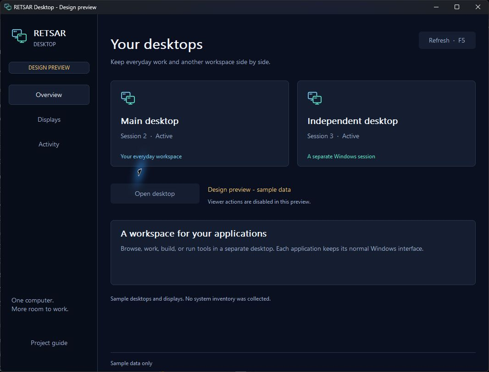

<p align="center">
  
</p>

<p align="center">
  <a href="https://github.com/kazah-png/RETSAR/actions/workflows/windows.yml"></a>
  <a href="LICENSE"></a>
  
  
</p>

<p align="center">
  <a href="#build-and-explore">Get started</a> ·
  <a href="docs/PRODUCT.md">Product direction</a> ·
  <a href="docs/ROADMAP.md">Roadmap</a> ·
  <a href="docs/PROGRESS.md">Verified progress</a> ·
  <a href="CONTRIBUTING.md">Contribute</a>
</p>

**RETSAR is an open-source project for independent, general-purpose Windows desktop workspaces on one computer.** The aim is a second usable desktop with its own applications and input, while the principal desktop remains available for everyday work.

RETSAR means **Runtime Environment for Terminal Sharing and Allocation of Resources**. Browsing, development, productivity and application testing are part of its intended scope. Roblox and Zzen were used in one supervised pilot; they are neither dependencies nor the definition of the product.

## The preview today

RETSAR has opened and resumed a real native Windows child desktop on the tested Core-edition host. A bounded input experiment delivered mouse and keyboard input there while sampled parent state stayed unchanged. A subsequent one-account Roblox/Zzen pilot confirmed automatic replay while the user reported normal mouse and keyboard use on the principal desktop.

**This is a development preview, not a production multiseat replacement.** General application compatibility, exclusive physical displays and devices, dependable session teardown, reconnect recovery and prolonged operation still require validation. The child desktop shares the user's profile; it is not a separate-account security boundary.

| Area | Available now | Still to prove or complete |
| --- | --- | --- |
| **RETSAR Desktop** | Native management console with Overview, Displays and Activity views; read-only refresh and guarded viewer actions | Complete desktop lifecycle and device assignment |
| **Desktop viewer** | Actual child-session creation and interactive resumption on the tested host | Unattended reconnect, reliable keyboard shortcuts and broader Windows coverage |
| **Input** | Exact synthetic mouse/key receipt in the child; a supervised application pilot | Exclusive physical keyboard/mouse ownership and continuous isolation |
| **Engine** | Validated plans, reservations, durable receipts and conservative recovery; simulated effects in tests | Integration with a production native provider |
| **Display research** | Observed console virtual-display lifecycle; remote IDD source builds and validates | Independent physical output and remote runtime acceptance |

The [evidence record](docs/PROGRESS.md) distinguishes implemented code, inert tests and live observations. A green build is not proof of a working physical seat.

## Build and explore

Use **Windows x64**, **Visual Studio Build Tools with C++**, the **Windows SDK** and **PowerShell**. Source builds are the primary development path; there is no production installer. Successful [Windows CI runs](https://github.com/kazah-png/RETSAR/actions/workflows/windows.yml) also provide a `RETSAR-desktop-preview-windows-x64` artifact with the console, viewer, usage guide and SHA-256 checksums. These unsigned developer snapshots retain the laboratory prerequisites described below.

```powershell
.\build.ps1 -Desktop
.\dist\RETSAR-Desktop.exe
```

The desktop build also compiles the child-session tools used by its guarded viewer action. Its checks invoke help and inert tests; it does not create or reconnect a desktop. The console observes current state and offers explicit actions when their prerequisites are met. An already active viewer is preserved.

For a visual preview with clearly labeled sample data and no session or device inventory:

```powershell
.\dist\RETSAR-Desktop.exe --preview
```

For the existing command-line tools:

```powershell
.\dist\RETSAR.exe --engine-status
.\dist\RETSAR.exe --json
```

`--engine-status` reports capability readiness without inspecting devices. `--json` explicitly requests read-only Windows, display, Raw Input metadata and session inventory; it does not record keystrokes.

**Current path constraints:** code and builds can remain on D:. Core journal and CLI test fixtures use a small temporary directory on C: automatically; the underlying C:-only file policy is unchanged. The child-session experiment currently keeps new receipts under `D:\RETSAR-Lab\RETSAR\private`. This is still a laboratory path constraint rather than a portable installation experience. [Desktop usage](docs/DESKTOP.md) · [Build and validation](CONTRIBUTING.md#build-and-test).

## A desktop-first experience



*Native Windows interface running in `--preview` mode. The screenshot contains illustrative sample data, not a live desktop status claim.*


The interface is organized around desktops, displays and activity. It shows observed state, offers useful next actions and keeps unavailable capabilities explicit. It does not present an application-specific bot panel or imply that a visible monitor has already been assigned to a separate seat.

The native implementation uses the Windows UI stack rather than a bundled web runtime. Refreshes are explicit, and idle repainting and background work are kept bounded. Performance improvements must be measured; no unverified RAM, CPU or FPS savings are advertised. [Product principles](docs/PRODUCT.md) · [Visual system](docs/DESIGN.md).

## Engineering and verification

The verified [desktop preview CI revision](https://github.com/kazah-png/RETSAR/actions/runs/43312642066/job/131512414242) passed **1,508 C++/CLI checks, 46 Python tests and 220 inert PowerShell checks**, with no failures or skipped adversarial branches. The same run produced the downloadable desktop preview with its guide and checksums. These totals describe commit [`da9491c`](https://github.com/kazah-png/RETSAR/commit/da9491ccc636bcef6d184ba043c0ffd9d08991b6); live desktop observations are tracked separately in [Verified progress](docs/PROGRESS.md).

The core records intent before changes, associates resource receipts with their originating run and preserves uncertainty instead of guessing ownership. Tests use an explicit simulated provider. Native session, driver and device experiments remain opt-in; normal builds and CI do not change the host's session or device configuration.

| Guide | What it covers |
| --- | --- |
| [Product direction](docs/PRODUCT.md) | General-purpose desktop scope and acceptance criteria |
| [Desktop console](docs/DESKTOP.md) | Interface, viewer actions and current usage limits |
| [Architecture](docs/ARCHITECTURE.md) | Core boundaries, ownership and recovery |
| [Child desktops](docs/CHILD-SESSIONS.md) | Connection, resumption and observed limits |
| [Input and application pilot](docs/CHILD-SESSION-INPUT.md) | Input correlation, parent observation and application evidence |
| [Native backend research](docs/NATIVE-BACKEND.md) | Physical-seat requirements and candidate mechanisms |
| [Laboratory](lab/README.md) | Isolated experiments and reproducible evidence |
| [Roadmap](docs/ROADMAP.md) | Capability gates and outstanding work |

## Contributing

Reports should describe a concrete problem, expected behavior and the environment used. Small, reproducible changes and honest measurements are welcome. See [CONTRIBUTING.md](CONTRIBUTING.md) for build instructions, validation scope and handling of private evidence.

## License and credits

Original RETSAR code and visual assets are released under [MIT](LICENSE). Maintained by [kazah-png](https://github.com/kazah-png).

Credits include **Ghidra**, **REA**, and assistance identified by the maintainer as **GPT-6 Astra ULTRA**. Their roles and provenance are recorded in [ACKNOWLEDGEMENTS.md](ACKNOWLEDGEMENTS.md). They are not build dependencies or endorsements of the project.
