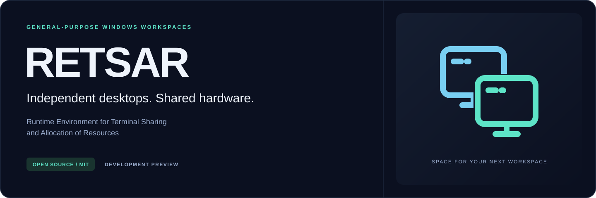

<p align="center">
  
</p>

<p align="center">
  <a href="https://github.com/kazah-png/RETSAR/actions/workflows/windows.yml"></a>
  <a href="LICENSE"></a>
  
  
</p>

<p align="center"><b>Un núcleo abierto para construir puestos independientes en Windows.</b><br>
Planes verificables · propiedad explícita · recuperación persistente</p>

<p align="center">
  <a href="#empezar">Compilar</a> ·
  <a href="docs/ARCHITECTURE.md">Arquitectura</a> ·
  <a href="docs/NATIVE-BACKEND.md">Investigación nativa</a> ·
  <a href="docs/ROADMAP.md">Hoja de ruta</a> ·
  <a href="docs/PROGRESS.md">Progreso verificable</a> ·
  <a href="ACKNOWLEDGEMENTS.md">Créditos</a> ·
  <a href="#english-summary">English</a>
</p>

## Estado actual

**RETSAR 0.2.0-engine-preview todavía no crea un segundo puesto Windows real.** Existe un núcleo transaccional en C++17, un diario persistente y un diagnóstico de solo lectura. El proveedor nativo continúa bloqueado: crear sesiones interactivas, asignar pantallas e independizar la entrada siguen pendientes.

La meta es disponer de dos puestos independientes en un mismo ordenador, con asignaciones explícitas de recursos. La versión actual permite revisar y probar los fundamentos de ese motor; no ofrece una aplicación multiseat lista para uso cotidiano.

| Componente | Estado comprobado |
| --- | --- |
| Inventario de Windows, pantallas y metadatos de entrada | Implementado, solo lectura |
| Planificación, reservas, arranque y retirada transaccionales | Implementados en el núcleo; efectos probados con proveedor simulado |
| Diario, recibos de propiedad y recuperación tras reiniciar | Implementados y probados |
| Creación de un puesto Windows real | **No implementada** |
| Pantalla física y teclado/ratón independientes | **No implementados** |
| Servicio, controladores e interfaz de gestión | Pendientes |

## Qué aporta el núcleo

- **Preparar antes de actuar.** Cada plan vincula configuración, reservas, caducidad e identidad del proveedor; solo se puede consumir una vez.
- **Registrar antes de modificar.** Las intenciones se confirman en el diario antes de pedir un efecto al proveedor.
- **Retirar solo lo propio.** Los recibos identifican ejecución, operación e instancia del recurso. Un ID reutilizado no autoriza su liberación.
- **Conservar la incertidumbre.** Una operación dudosa exige reconciliación; no provoca una segunda creación a ciegas.
- **Separar pruebas y realidad.** El proveedor simulado solo se compila en las pruebas. El ejecutable público declara las capacidades Windows pendientes.

## Empezar

Necesitas Windows x64, Visual Studio Build Tools con herramientas de C++ y Windows SDK, además de PowerShell. Para ejecutar la suite, coloca el repositorio en una carpeta ordinaria de **C:**: el diario y los informes de esta versión restringen sus archivos a esa unidad.

```powershell
.\build.ps1 -Test
.\dist\RETSAR.exe --engine-status
```

La primera orden compila con C++17 y `/W4 /WX`, y ejecuta las pruebas del modelo, persistencia, motor y CLI. La segunda muestra el estado del proveedor **sin consultar dispositivos, abrir un diario ni crear sesiones**.

Para consultar el inventario de solo lectura:

```powershell
.\dist\RETSAR.exe --json
```

Este informe incluye versión de Windows, sesión actual, monitores visibles, metadatos Raw Input y sesiones que WTS permita consultar. No registra pulsaciones. La visibilidad de sesiones puede ser parcial.

Para guardar un informe, `--output` exige un archivo **nuevo** dentro de una carpeta existente de C:; no sobrescribe. Consulta `--help` para ver la sintaxis. El CLI actual no tiene órdenes para iniciar puestos, asignar dispositivos o instalar componentes.

## Instrumento de laboratorio

También se incluye una sonda independiente, preparada para medir datos dentro de una sesión candidata. Para compilarla sin abrir su ventana:

```powershell
.\build.ps1 -Test -Lab
.\dist\lab\RETSAR-seat-probe.exe --help
```

La compilación solo ejecuta la ayuda. El modo interactivo requiere identificar explícitamente la sesión candidata y la de referencia; todavía no se ha probado en un puesto de laboratorio. No crea sesiones ni demuestra independencia por observar un ID. Véase el [contrato y alcance de la sonda](docs/NATIVE-BACKEND.md#instrumento-c-de-laboratorio).

## Verificación y límites

La validación local registrada el **10 de noviembre de 2026** terminó con **117 comprobaciones aprobadas**, validación adicional de JSON y **una rama adversarial no ejercitada**. El sistema denegó la conversión de la carpeta de prueba en junction; ese caso no se contabiliza como aprobado. El [registro de progreso](docs/PROGRESS.md) separa las 88 comprobaciones del núcleo/CLI y las 29 comprobaciones puras añadidas para la sonda de laboratorio.

Estas pruebas no acreditan aislamiento físico, compatibilidad de aplicaciones, estabilidad durante horas ni un proveedor Windows operativo. El CRC del diario detecta corrupción; no proporciona autenticación ni protección frente a restaurar una versión anterior íntegra del archivo.

El [flujo de Windows](.github/workflows/windows.yml) recompila y ejecuta las pruebas en GitHub Actions. El distintivo superior refleja ese flujo, no la disponibilidad del multiseat nativo.

## Contribuir

Las prioridades están en la [hoja de ruta](docs/ROADMAP.md). Son especialmente útiles las revisiones del contrato de propiedad y persistencia, pruebas de fallos reproducibles y evidencia documentada para el proveedor nativo. Describe qué se observó, en qué entorno y qué sigue sin comprobarse.

Los cambios que actúen sobre sesiones o dispositivos deben mantener el aislamiento respecto a recursos ajenos y aportar una validación independiente. Hasta entonces, `WindowsBlockedExecutor` permanece bloqueado.

## Licencia y créditos

El código propio y los recursos visuales originales de RETSAR se publican bajo [MIT](LICENSE). Mantenimiento: [kazah-png](https://github.com/kazah-png).

Créditos a **Ghidra**, **REA** y a la asistencia identificada por el mantenedor como **GPT-6 Astra ULTRA**. Consulta [Agradecimientos y procedencia](ACKNOWLEDGEMENTS.md) para ver sus funciones, fuentes y licencias. No son dependencias necesarias para compilar RETSAR.

## English summary

**RETSAR — Runtime Environment for Terminal Sharing and Allocation of Resources** is an MIT-licensed C++17 project building the foundations for independent Windows seats.

This engine preview includes read-only inventory, transactional lifecycle management, ownership receipts and a durable journal. **It cannot create a real Windows seat yet.** Native session creation, display assignment and independent input remain unimplemented. Lifecycle tests use an explicit test-only simulated provider; production capabilities stay blocked.

Build from an ordinary directory on drive C: with `.\build.ps1 -Test`. Inspect readiness with `.\dist\RETSAR.exe --engine-status`. See the [architecture](docs/ARCHITECTURE.md), [roadmap](docs/ROADMAP.md) and [verified progress](docs/PROGRESS.md).
