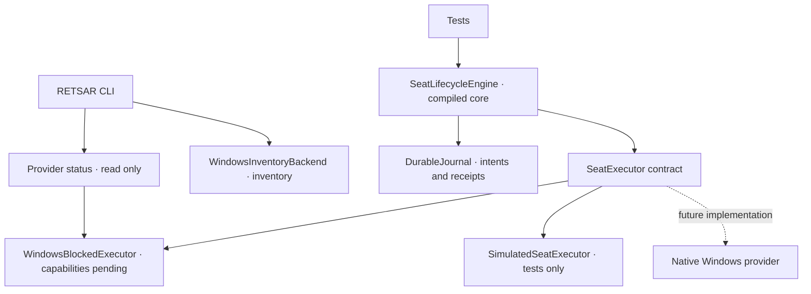

# Architecture

RETSAR separates system observation, transactional lifecycle management and the provider responsible for native operations. The public executable can inspect the host and report capabilities, but it cannot start a Windows seat.

The core is linked into the production build. The CLI does not expose its mutation methods. `SimulatedSeatExecutor` lives in `tests/` and is not available as a product execution mode.

## Components

| File | Responsibility |
| --- | --- |
| `src/model.hpp` | Configuration, capabilities and structural validation |
| `src/windows_inventory.cpp` | Windows, monitor, Raw Input metadata and visible-session diagnostics |
| `src/lifecycle.hpp` / `.cpp` | Plans, reservations, transitions, ownership and recovery |
| `src/executor.hpp` | Provider contract and blocked Windows provider |
| `src/journal.hpp` / `.cpp` | Exclusive journal, bounded format and durable writes |
| `src/safe_c_path.hpp` | File opens relative to retained parent handles, restricted to C: |
| `src/lab/seat_probe.cpp` | Separate instrument for observing an explicitly selected candidate session |
| `tests/simulated_executor.hpp` | Test provider and controlled failure points |

## Lifecycle

`Prepare(config)` validates the plan, checks capabilities and availability, reserves logical resources and returns a temporary token. That token binds the configuration, generation, provider and engine instance. Preparation creates no physical resources.

`Commit(token)` consumes the token and persists each intent before requesting an effect. The intended order is session, output, then input. Every binding requires the exact session identity belonging to that run; there is no fallback to the current session.

`Stop(runId, generation)` removes resources in reverse order. It verifies the full receipt before release and checks the result afterward. A reservation with no effects can be canceled as a purely logical operation.

`Recover()` reconciles in read-only mode. It neither repeats creations nor automatically releases resources. `Status()` distinguishes recorded state from verified live state: a historical `Running` restored from disk is exposed as `RecoveryRequired`, not proof that a seat is still alive.

## Provider invariants

1. **Ownership is more than an ID.** A receipt includes the run, owner, operation, provider and concrete resource incarnation. A reused number is not the same resource.
2. **Unknown does not mean free.** Availability must be checked and maintained through each operation.
3. **Uncertainty retains reservations.** An in-flight result is `Unknown`. `NoEffectFinal` requires durable termination with no possible later effect.
4. **Operations are idempotent.** Reusing an operation identifier with a different request must be rejected.
5. **The revision distinguishes external interference.** A transaction's own effects must remain coherent with its reserved view; an external change revokes the plan.
6. **Release rechecks ownership.** An earlier check does not authorize removing a resource that has changed owners.

## Persistence

The journal enforces one writer, sequences and checksums. It confirms writes with `FlushFileBuffers`. It records intent before each acquisition or release, then the receipt after verifying the outcome. A persistence failure prevents the current engine instance from continuing to mutate resources from uncertain state.

`DurableJournal(path)` opens only an existing journal. Creating one requires `JournalOpenMode::CreateNew` and never overwrites another file. An invalid header, wrong sequence or partial record blocks opening; the tail is not silently discarded.

New snapshots use `retsar.lifecycle.v1`. Reading the former identifier and retaining the binary journal signature preserve internal compatibility. The C++ namespace `seats` is also an internal implementation detail.

**Limits:** CRC does not authenticate the file. Removing a suffix of complete records or restoring an older complete journal may leave a valid prefix; there is no external anti-rollback anchor. The file is limited to 32 MiB and has no automatic compaction. Current tests are not an exhaustive certification of disk or power-failure tolerance.

## Files and observation

Report and journal paths are restricted to ordinary files on C:. Parent directories are opened component by component, relative to retained handles, with `OBJ_DONT_REPARSE`. This avoids resolving the whole absolute path again after checking it. Reparse points, device names, alternate streams and ambiguous names are rejected. API references: [NtCreateFile](https://learn.microsoft.com/en-us/windows/win32/api/winternl/nf-winternl-ntcreatefile) and [OBJECT_ATTRIBUTES](https://learn.microsoft.com/en-us/windows/win32/api/ntdef/ns-ntdef-_object_attributes).

The local adversarial junction test could not exercise redirection because Windows rejected the mutation. The public CI environment exercised and passed that branch. Both observations remain distinct in [PROGRESS.md](PROGRESS.md).

`--engine-status` opens no journal and performs no inventory query. `--json` queries device and session metadata; it does not listen to keyboard or mouse events. Inventory APIs may expose only a partial view, so absence from a report does not prove a resource is free.

## Laboratory instrument

`RETSAR-seat-probe` is a separate executable. Its interactive path requires explicit candidate and reference session IDs and verifies that its own process already belongs to the candidate before observing graphics or opening a window. It does not create or select a new session.

The ordinary build and test suite run only its help and pure tests. Interactive behavior, graphics creation and independent input remain unverified in a real laboratory session. Its [full contract](NATIVE-BACKEND.md#c-laboratory-instrument) explains what each observation can and cannot establish.

## Pending integration

The next obstacle is demonstrating creation and removal of a real interactive session with independent display and input. The contract and journal provide an integration path but do not implement those operating-system mechanisms. Read the [native backend investigation](NATIVE-BACKEND.md) and [P0/P1 acceptance criteria](ROADMAP.md) before enabling Windows provider capabilities.
