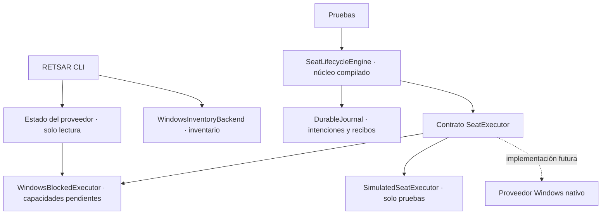

# Arquitectura

RETSAR separa la observación del sistema, el motor transaccional y el proveedor que algún día realizará las operaciones nativas. En esta versión, el ejecutable público puede observar y declarar capacidades, pero no iniciar un puesto Windows.

El núcleo se enlaza en la compilación de producción. El CLI todavía no expone sus métodos de mutación. `SimulatedSeatExecutor` vive en `tests/` y no se ofrece como modo de ejecución del producto.

## Componentes

| Archivo | Responsabilidad |
| --- | --- |
| `src/model.hpp` | Configuración, capacidades y validación estructural |
| `src/windows_inventory.cpp` | Diagnóstico de Windows, monitores, metadatos Raw Input y sesiones visibles |
| `src/lifecycle.hpp` / `.cpp` | Planes, reservas, transiciones, propiedad y recuperación |
| `src/executor.hpp` | Contrato del proveedor y proveedor Windows bloqueado |
| `src/journal.hpp` / `.cpp` | Diario exclusivo, formato acotado y confirmación de escrituras |
| `src/safe_c_path.hpp` | Aperturas de archivos relativas a carpetas retenidas, limitadas a C: |
| `tests/simulated_executor.hpp` | Proveedor de pruebas y puntos de fallo controlados |

## Ciclo de vida

`Prepare(config)` valida el plan, comprueba capacidades y disponibilidad, reserva recursos lógicos y devuelve un token temporal. El token vincula configuración, generación, proveedor e instancia del motor. Preparar no crea recursos físicos.

`Commit(token)` consume el token y persiste cada intención antes de solicitar un efecto. El orden previsto es sesión, salida y entrada. Cada vínculo exige la identidad exacta de la sesión que pertenece a esa ejecución; no existe una alternativa que use la sesión actual.

`Stop(runId, generation)` retira los recursos en orden inverso. Antes de liberar verifica el recibo completo y después comprueba el resultado. Una reserva sin efectos puede cancelarse de forma puramente lógica.

`Recover()` reconcilia en modo de solo lectura. No repite creaciones ni libera recursos automáticamente. `Status()` distingue el estado registrado del estado verificable: un `Running` restaurado del disco aparece como `RecoveryRequired`, no como prueba de que el puesto siga vivo.

## Invariantes del proveedor

1. **La propiedad supera al ID.** El recibo incluye ejecución, propietario, operación, proveedor e instancia concreta. Un número reutilizado no es el mismo recurso.
2. **Desconocido no significa libre.** La disponibilidad debe comprobarse y mantenerse durante cada operación.
3. **La incertidumbre conserva reservas.** Un resultado en vuelo es `Unknown`. `NoEffectFinal` exige una terminación duradera sin posibilidad de efecto posterior.
4. **Una operación es idempotente.** Repetir su identificador con una solicitud diferente debe rechazarse.
5. **La revisión distingue interferencias externas.** Los efectos propios de una transacción deben ser coherentes con su vista reservada; un cambio externo revoca el plan.
6. **La liberación vuelve a comprobar propiedad.** Una comprobación anterior no autoriza a eliminar un recurso que haya cambiado de dueño.

## Persistencia

El diario mantiene un único escritor, secuencias y checksums; confirma sus escrituras con `FlushFileBuffers`. Guarda la intención antes de cada adquisición o liberación y el recibo después de verificar el resultado. Un fallo al persistir impide que el motor siga modificando recursos desde ese estado incierto.

`DurableJournal(path)` abre únicamente un diario existente. La creación requiere `JournalOpenMode::CreateNew` y no sobrescribe otro archivo. Una cabecera inválida, una secuencia incorrecta o un registro parcial impiden abrirlo; no se descarta automáticamente la cola.

Las nuevas instantáneas usan `retsar.lifecycle.v1`. Se conserva lectura del identificador anterior y la firma binaria del diario para mantener compatibilidad interna. El namespace C++ `seats` tampoco constituye una marca visible del producto.

**Límites:** el CRC no autentica el archivo. Eliminar una cola formada por registros completos o restaurar una versión íntegra anterior puede dejar un prefijo válido; no hay un ancla externa que lo detecte. El archivo está acotado a 32 MiB y no existe compactación automática. Las pruebas actuales no son una certificación exhaustiva de tolerancia a fallos de disco o energía.

## Archivos y observación

Las rutas de salida y de diario se limitan a archivos ordinarios en C:. Los padres se abren por componentes relativos a handles retenidos, con `OBJ_DONT_REPARSE`, para evitar volver a resolver toda la ruta tras comprobarla. Se rechazan reparses, nombres de dispositivo, flujos alternativos y nombres ambiguos. Referencias de la API: [NtCreateFile](https://learn.microsoft.com/en-us/windows/win32/api/winternl/nf-winternl-ntcreatefile) y [OBJECT_ATTRIBUTES](https://learn.microsoft.com/en-us/windows/win32/api/ntdef/ns-ntdef-_object_attributes).

La comprobación adversarial local de conversión de junction no llegó a ejercitar la redirección: Windows denegó el cambio. Esa limitación permanece registrada en [PROGRESS.md](PROGRESS.md).

`--engine-status` no abre un diario ni consulta el inventario. `--json` consulta metadatos de dispositivos y sesiones; no escucha eventos de teclado/ratón. Las APIs de inventario pueden ofrecer una vista parcial, por lo que una ausencia en el informe no demuestra que un recurso esté libre.

## Integración pendiente

El obstáculo siguiente es demostrar creación y retirada de una sesión interactiva real con pantalla y entrada independientes. El contrato y el diario ya proporcionan una ruta de integración, pero no implementan esos mecanismos del sistema operativo. Consulta la [investigación del backend nativo](NATIVE-BACKEND.md) y los criterios de [P0 y P1](ROADMAP.md) antes de habilitar capacidades del proveedor Windows.
